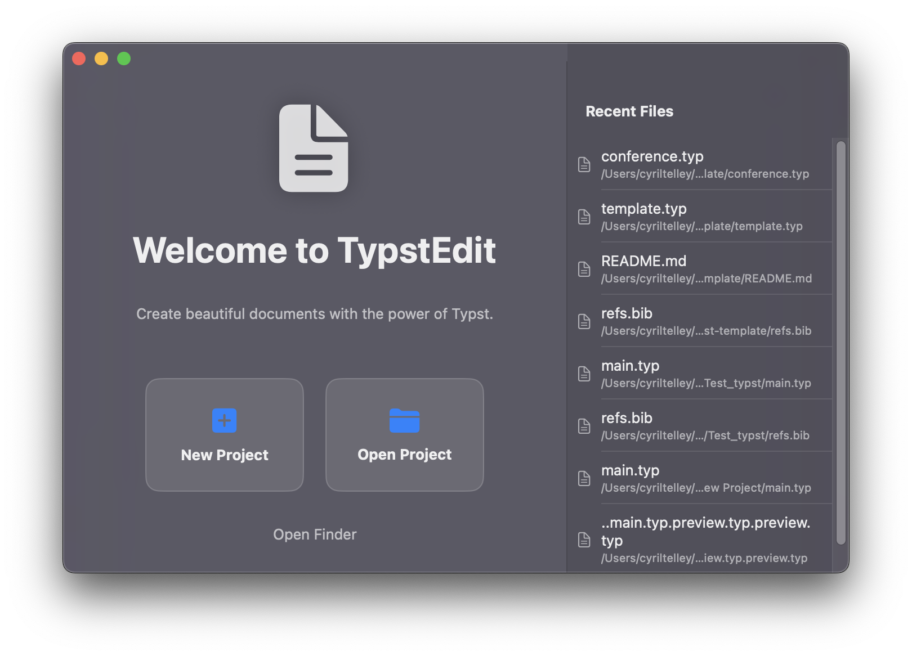
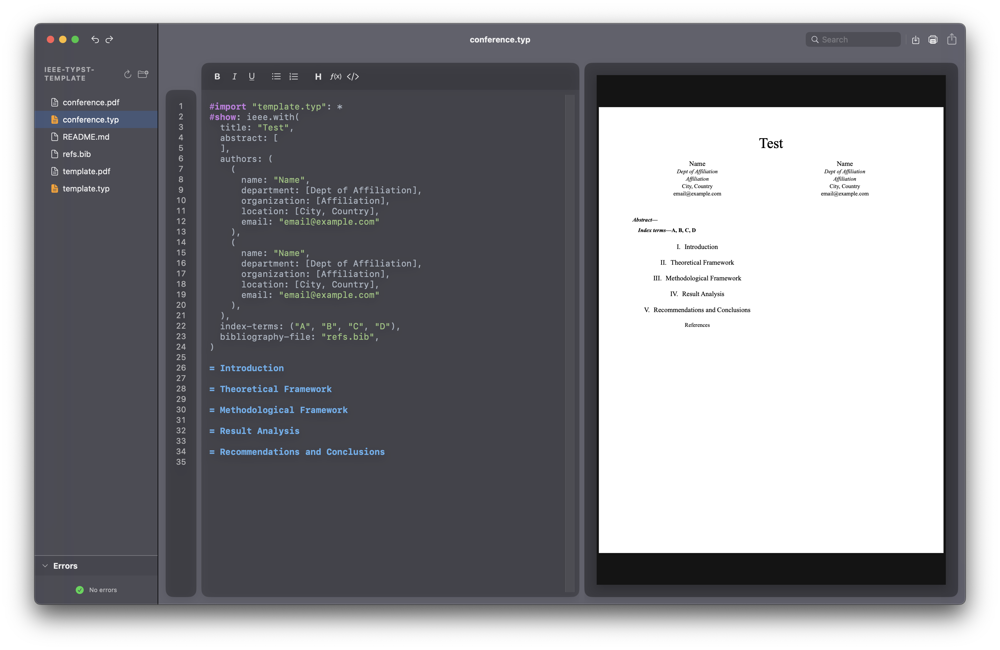

# TypstEdit

<p align="center">
  
</p>

<p align="center">
  <b>A lightweight, native macOS editor for Typst.</b>
</p>

<p align="center">
  <a href="#installation">Download</a> • 
  <a href="#features">Features</a> • 
  <a href="#ai-assistant">AI Assistant</a> • 
  <a href="#building-from-source">Build</a>
</p>

---

**TypstEdit** is a native SwiftUI application designed to make writing [Typst](https://typst.app) documents on macOS seamless and efficient. It combines a robust text editor with a live preview, leveraging the speed of the native Typst CLI.




## ✨ Features

### Core Editing
* **⚡️ Save Preview:** Real-time compilation and preview of your document as you save the document.
* **🎨 Advanced Syntax Highlighting:** Refined native syntax highlighting for Typst with accurate keyword, function, and markup styling.
* **🔍 Find and Replace:** Powerful search functionality with editor scrolling to results.
* **🔢 Line Numbers:** Helpful ruler for code navigation.
* **📝 Rich Text Formatting:** Support for bold, italic, underline, strikethrough, highlight, subscript, and superscript.
* **📋 List Support:** Bullet lists, numbered lists, and **description lists** with one-click insertion.
* **💬 Code Blocks & Quotes:** Inline code, code blocks, and block quotes with syntax support.
* **🔄 Markdown Auto-Conversion:** Paste Markdown directly into your `.typ` files and it will automatically convert to native Typst syntax! *(Note: Highly complex Markdown syntax may occasionally fail to convert perfectly, so please review and correct the output after pasting).*

### Visual Editors
* **🧮 Visual Equation Editor:** Interactive equation editor with live LaTeX preview for mathematical expressions.
* **🖥️ Calculator Mode:** TI-89 style CAS home screen (solve, factor, d, ∫, Σ, matrices, exact/approx, ans recall) powered by the bundled Giac engine — right-click any result to insert it into your document as Typst math, save sessions as `.tcalc` files, browse a verified function catalogue, and let AI Chat evaluate math with `evaluate_math`. See `Docs/calculator.md`.
* **🖼️ Figure Editor:** Visual interface for inserting and editing figures with captions and references.
* **🔧 Foundation Item Picker:** Drill-down navigation for Typst foundation items (arrays, strings, datetime, calc, etc.) with searchable methods and properties.
* **🎯 Contextual Editing:** Smart "Edit at Cursor" feature that detects and opens appropriate editors for tables, links, equations, and more.

### Project & File Management
* **🚀 Project Templates:** Start quickly with built-in templates for **Articles, Reports, Presentations, and Resumes**.
* **📁 Project Sidebar:** Easily navigate through your project files.
* **📥 LyX Import:** Convert LyX documents to Typst format with automatic font, page size, and heading detection.
* **📤 Export Options:** Export to PDF, PNG, SVG, or Markdown formats.
* **💾 Project Backup:** One-click project backup functionality.

### Smart Snippets & Insertion
* **🧩 Smart Snippets:** Quickly insert complex elements like **Tables, Charts, Timelines, and Outlines** with one click.
* **🔗 Quick Insert Menu:** Easy access to symbols, external data, document styles, and more.
* **⌨️ Comprehensive Keyboard Shortcuts:** Full keyboard shortcuts for all insert menu items and formatting options.

### Typst Compiler Management
* **🔄 Typst Compiler Updates:** Built-in updater to download and install the latest Typst compiler.
* **⚙️ Flexible Update Modes:** Choose between stable pre-compiled binaries or bleeding-edge source builds.
* **🛠️ Custom Compiler Path:** Support for custom Typst binary locations.

### User Experience
* **🍎 Native macOS Experience:** Built with SwiftUI. 100% Native, fast, and lightweight.
* **🐞 Error Reporting:** Integrated error panel to quickly spot compilation issues.
* **🌑 Dark Mode Optimized:** Designed for a comfortable, eye-friendly dark editing environment.
* **♿️ Accessibility Features:** Color blindness simulation modes (Protanopia, Deuteranopia, Tritanopia).
* **📐 Flexible Layout:** Split views vertically or horizontally, editor-only, preview-only, or both panels.

### AI (100% opt-in)
* **🤖 Assistant:** Autocomplete, cursor-insertion prompts, selection rewrite/grammar fixes, and a persistent agentic chat panel — each configurable to OpenAI, Anthropic, Gemini, OpenRouter, or a local model.
* **🧩 Skills, Tools & Search:** Reusable Skills, your own MCP tools, and semantic project search (RAG), enabled per request.
* **🔒 Safety First:** File edits and code execution always need your approval, with a diff/code preview, unless you opt into YOLO mode — and the AI can't see outside the open project.
* **🔌 MCP Server & CLI:** Let external agents (Claude Code, Codex, opencode, …) check and compile your documents, or script from the terminal with `typstedit`.

See **[AI Assistant & Agent Integration](#ai-assistant)** below for the full rundown.

<a id="ai-assistant"></a>
<details>
<summary><b>🧠 AI Assistant & Agent Integration</b> — click to expand (100% opt-in, every provider/tool is off until you turn it on)</summary>

Pick a provider per task in **Settings → AI** — OpenAI, Anthropic, Google Gemini, OpenRouter, or a local OpenAI-compatible server like Ollama/LM Studio. Nothing talks to a model until you enable it.

### Autocomplete, AI Prompt, Refine & Grammar
* **Autocomplete** offers inline ghost-text suggestions as you type, using whichever model you've assigned to the *Completion* task (a fast local model works well here).
* **AI Prompt** (**⌃⌘A**, or Insert → AI Prompt…) generates or rewrites content at the cursor from a single instruction, optionally using enabled **Skills** and **MCP tools**.
* **Refine Writing** / **Fix Grammar**, from the editor's right-click menu, rewrite the current selection and show a preview you accept or reject.

### AI Chat Panel
Toggle with **⌘⇧J** (or the status bar icon). Unlike AI Prompt, this is an ongoing, persistent conversation scoped to your whole open **project** — or just the current **notebook**, for notes — with its own agentic tool-calling loop. The chat never sees anything outside that scope: every path a tool touches is checked in code, not just told to behave in the prompt.

Built-in tools (always available, no MCP server required):

| Tool | What it does |
|---|---|
| `list_files` | Lists files in the project/notebook; folders appear with a trailing `/`, so even an empty delivery folder can be confirmed. |
| `read_file` | Reads a file, paged — large files come back a window at a time instead of flooding the conversation. |
| `grep_project` | Case-insensitive by default; exact-string or regex search across the project, with a glob filter. |
| `search_project` | Semantic (RAG) search, falling back to a literal scan if nothing semantic matches. |
| `edit_file` | Precise find-and-replace on a file it has already read — cheaper and safer than rewriting the whole thing. Automatically compiles the `.typ` file it just touched and reports the result (success or the compiler error) in its own output, so a mismatched delimiter gets caught immediately instead of left behind. |
| `write_file` | Creates or overwrites a whole file — same automatic compile check as `edit_file` for `.typ` files. |
| `export_document` | Compiles a `.typ`/`.md`/`.note` document to PDF, PNG or SVG with the same pipeline as the editor's Export As. Output stays in the project/notebook scope and is approved first. |
| `export_markdown` | Converts a `.typ`/`.note` document to a Markdown copy with the editor's own converter (or copies an `.md` through), showing the diff before writing. |
| `create_folder` | Creates an empty delivery/evidence folder (and missing parents) inside the scope. |
| `copy_files` | Copies related files or folders into a delivery folder in one approved batch, preserving names; existing items are only replaced with `overwrite: true`. |
| `convert_markdown_to_typst` | Runs text through the same Markdown→Typst converter the editor uses when you paste — lets the AI write in Markdown instead of guessing at Typst syntax it's unsure of. |
| `read_skill_file` | Reads a file attached to a currently enabled Skill. |
| `run_typst_check` | Compiles a snippet, or an existing file in place, to check for errors on demand — without touching your document. |
| `evaluate_math` | Evaluates one math expression with the bundled Giac CAS, exact or approximate: arithmetic, algebra, calculus, matrices. Returns plain text and Typst math. No project, Python, file, or network access is needed. |
| `web_fetch` (opt-in) | Fetches a public web page as readable text. Private/loopback/internal addresses are always refused (even via a redirect), no credentials are ever sent, and every fetch needs its own approval showing the full URL. |
| `run` (Python, opt-in) | Runs a short Python script, sandboxed by default — no network access, writes limited to a scratch folder. |

Anything that changes a file or runs code is shown to you first — a diff for writes/edits, the exact code for Python — and needs your approval, unless you turn on **YOLO mode** (a session-only toggle, with a confirmation dialog) to auto-approve everything for the rest of the session. YOLO never relaxes the project/notebook scope boundary. The automatic compile check is purely advisory — it never blocks a write — and can be turned off in Settings → AI Chat. If a file the AI (or another program) changes is open in an editor window with no unsaved edits, that window reloads it automatically. With unsaved edits in the way, it doesn't interrupt you — a small reload button lights up (next to the toolbar, same idea as the PDF preview's refresh button) so you can review and decide when you're ready, instead of a popup grabbing focus mid-edit.

For multi-step requests, the chat keeps a visible task checklist (`update_plan`), and can delegate large research jobs to a **read-only subagent** (`delegate_task`) that explores in its own context and reports back only its findings. If the model exposes reasoning/"thinking" content, it's shown collapsed under the reply. A context-size estimate sits in the chat header against a configurable budget; once a conversation grows past it, older turns are automatically (or manually) summarized so the chat keeps working instead of failing with an empty response.

### Skills, MCP Tools & Semantic Search
* **Skills** are reusable, portable instruction sets — the same idea as Claude Code/OpenCode's Agent Skills — stored as a `SKILL.md` folder, either global or project-scoped (`.typstedit/skills/`, shareable via git), with optional **attachments** the AI reads only when it actually needs them.
* **MCP Tools:** add your own [MCP](https://modelcontextprotocol.io) servers in **Settings → MCP Servers** and enable them per request to give AI Prompt/Chat extra tools.
* **Semantic Project Search (RAG):** a local embedding index over your project's files, enriching prompts and powering `search_project`.

### AI Agents & Command Line (TypstEdit as a tool for *other* agents)

Open **Settings → Integrations** and click **Install** to add the `typstedit` command. It then prints ready-to-paste MCP configs for common agents.

```sh
typstedit check report.typ            # errors/warnings as file:line:col (exit 1 on errors)
typstedit check report.typ --json     # machine-readable diagnostics
typstedit compile report.typ          # → report.pdf
typstedit compile notes.md out.png --ppi 200   # Markdown/.note files are converted first
echo '= Hi' | typstedit check -       # source from stdin
typstedit open report.typ             # show it in the editor
```

To connect an agent, register an MCP server with command `typstedit` and argument `mcp`, e.g.:

```sh
claude mcp add --scope user typstedit -- typstedit mcp
```

```json
{ "mcpServers": { "typstedit": { "command": "typstedit", "args": ["mcp"] } } }
```

If you skip the install, use the full path `/Applications/TypstEdit.app/Contents/MacOS/TypstEdit` as the command. Tools exposed: `typst_check`, `typst_compile`, `typst_render_preview` (returns page images), `typstedit_open` and `typstedit_info`.

</details>

## 📥 Installation

TypstEdit is available for both **Apple Silicon** (M1/M2/M3) and **Intel** Macs.

1.  Go to the [Releases](../../releases) page.
2.  Download the correct installer for your Mac:
    * **Apple Silicon (M1/M2/M3):** Download `TypstEdit_AppleSilicon.dmg`
    * **Intel Macs:** Download `TypstEdit_Intel.dmg`
3.  Open the `.dmg` and drag the app to your **Applications** folder.
## 🛠️ Building from Source

If you want to contribute or build the app yourself:

### Prerequisites
* macOS 13.0+ (Ventura) or later to run; building needs a recent macOS.
* **Xcode 26+ (Swift 6.2+)** installed — the package uses `swift-tools-version: 6.2`. Full Xcode is required for universal builds; Command Line Tools alone ship an Apple-Silicon-only copy of the Swift compatibility runtime.
* For the Calculator's CAS helper: Homebrew `autoconf`, `automake`, `libtool`, and `bash` (`brew install autoconf automake libtool bash`).

### Steps

1.  **Clone the repository:**
    ```bash
    git clone https://github.com/tmagri/TypstEdit.git
    cd TypstEdit
    ```

2.  **Ensure the Typst binaries are present:**
    Place `typst-aarch64-apple-darwin/typst` (Apple Silicon),
    `typst-x86_64-apple-darwin/typst` (Intel), and for universal builds the
    combined `typst-universal`.

3.  **Build the app (universal, recommended):**
    ```bash
    ./bundle_universal.sh
    ```
    This builds one app that runs on both Apple Silicon and Intel Macs. The
    first run also builds the Calculator's CAS helper (allow 20–40 minutes per
    architecture; later runs reuse the cached libraries).

    For a single-architecture app on this Mac, use `./bundle.sh` (defaults to
    this Mac's architecture).

    Both scripts finish by running `Tools/packaging/verify_bundle.sh`, which
    fails the build if the app could not launch on another Mac — for example
    a missing bundled Swift runtime, a wrong architecture, or a library that
    needs a newer macOS than the app declares.

4.  **Create Installer (Optional):**
    ```bash
    ./create_dmg.sh            # universal (TypstEdit_Universal.dmg)
    ./create_dmg.sh arm64      # Apple Silicon only
    ./create_dmg.sh x86_64     # Intel only
    ```

### Build separate architecture binaries

In VS Code, run **swift: build all (arm64 + Intel x86_64)** to build two separate
release binaries. The task builds ARM64 and Intel sequentially; it does not
combine them into a universal binary. You can also run either architecture task
individually:

* **swift: build (arm64)**
* **swift: build (Intel x86_64)**

The binaries are written to
`.build/arch-build/arm64/out/Products/Release/TypstEdit` and
`.build/arch-build/x86_64/out/Products/Release/TypstEdit`, respectively.

### Publish installers

`./create_dmg.sh` (no argument) creates `TypstEdit_Universal.dmg`, one
installer for every Mac. The VS Code **publish: installer** tasks still build
the separate `TypstEdit_AppleSilicon.dmg` and `TypstEdit_Intel.dmg` if you
prefer smaller per-architecture downloads.

### ⚠️ "App is damaged" / "can't be opened" on another Mac

The app is ad-hoc signed, not signed with a paid Apple Developer ID or
notarized, so Gatekeeper blocks it the first time it is opened after a
download.

**To fix this (once per Mac):**

1. Drag **TypstEdit** from the DMG to **Applications**.
2. Open **Terminal** and run:
   ```bash
   xattr -dr com.apple.quarantine /Applications/TypstEdit.app
   ```
3. Open the app normally. (Alternatively: right-click the app → **Open** →
   **Open**.)


## 📄 License

This project is open source. 

MIT License

Copyright (c) 2024-2026 SuperMegaFort, tmagri

Permission is hereby granted, free of charge, to any person obtaining a copy
of this software and associated documentation files (the "Software"), to deal
in the Software without restriction, including without limitation the rights
to use, copy, modify, merge, publish, distribute, sublicense, and/or sell
copies of the Software, and to permit persons to whom the Software is
furnished to do so, subject to the following conditions:

The above copyright notice and this permission notice shall be included in all
copies or substantial portions of the Software.

THE SOFTWARE IS PROVIDED "AS IS", WITHOUT WARRANTY OF ANY KIND, EXPRESS OR
IMPLIED, INCLUDING BUT NOT LIMITED TO THE WARRANTIES OF MERCHANTABILITY,
FITNESS FOR A PARTICULAR PURPOSE AND NONINFRINGEMENT. IN NO EVENT SHALL THE
AUTHORS OR COPYRIGHT HOLDERS BE LIABLE FOR ANY CLAIM, DAMAGES OR OTHER
LIABILITY, WHETHER IN AN ACTION OF CONTRACT, TORT OR OTHERWISE, ARISING FROM,
OUT OF OR IN CONNECTION WITH THE SOFTWARE OR THE USE OR OTHER DEALINGS IN THE
SOFTWARE.

## ❤️ Credits

* Built for [Typst](https://typst.app).
* Uses the official Typst CLI binary.
